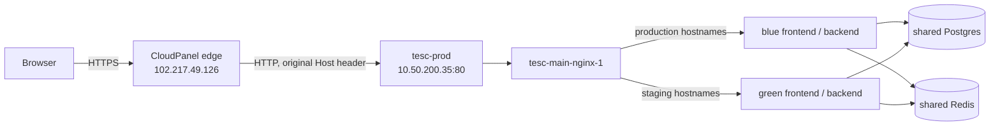

# TESC Nginx and Docker Routing: A VM Setup Guide

**Date:** 2026-11-02
**Project:** TESC
**Type:** Architecture Guide / Live System Inspection
**Status:** Completed

## Summary
This guide explains the routing actually running on `tesc-prod` and gives a pattern for another application on another VM. One Dockerized Nginx container receives HTTP from an upstream TLS edge, selects a blue or green application color by hostname and path, and reaches containers by Docker DNS over a shared bridge network. A deployment builds the inactive color, checks it, then changes traffic with one Nginx reload. All observations below were read-only; no TESC VM configuration was changed.

## Context / Trigger
A developer needs to understand TESC's current VM topology and reproduce its useful parts for a separate system. Older TESC deployment documents describe retired flows, so this guide was checked against the live containers, mounted Nginx config, scripts, and host-header responses on 2026-11-02.

## Scope
Included: routing, Docker network and Compose ownership, blue/green cutover, TLS boundary, operational checks, and a reusable setup sequence. Excluded: copying secrets, changing TESC production, inspecting the separate CloudPanel host directly, and designing the new system's application-specific migrations or authentication.

## Method
Inspected `docker ps`, `docker inspect` labels/mounts/networks, `nginx -T`, the three Compose files, the blue/green scripts and markers, public DNS, and local Host-header responses. Compared these with the existing TESC blue/green deployment report. Actual running image tags and Nginx upstream names were treated as authoritative when they differed from markers or older documentation.

## Decisions & Findings

### 1. Live request path



The external CloudPanel reverse proxy and TLS termination are documented in the prior TESC deployment report. This inspection confirmed that the public hostnames resolve to `102.217.49.126` and return HTTPS 200, while the VM's Nginx config listens only on port 80. CloudPanel's live configuration was not directly inspected here. Its reverse proxy must preserve the original `Host` header so TESC Nginx selects the correct `server_name`.

### 2. Which files and containers own each layer

The live checkout is `/home/user/Documents/TESC-main` on `tesc-prod`. The base stack is Compose project `tesc-main`, using `docker-compose.yml` plus `docker-compose.override.yml`; the blue/green application tier is defined separately in `docker-compose.bluegreen.yml`.

| Layer | Live owner | Purpose |
|---|---|---|
| Edge HTTPS | Separate CloudPanel host | Public TLS and proxy to the VM's port 80 |
| VM entrypoint | `tesc-main-nginx-1` from base Compose | Only Nginx container; publishes host ports 80 and 443 |
| Live Nginx config | `nginx/nginx.conf` | Hostname and path routing; mounted as `./nginx:/etc/nginx:ro` |
| Docker network | `tesc-main_main_net` | Nginx, both colors, legacy app stack, Postgres, Redis |
| Stateful services | `tesc-main-db-1`, `tesc-main-redis-1` | Shared by blue and green; not switched at cutover |
| Colored apps | `backend-{blue,green}`, `celery-worker-{blue,green}`, `frontend-client-v2-{blue,green}`, `frontend-admin-v2-{blue,green}` | Two copies of the stateless application tier |
| Legacy app tier | `tesc-main-backend-1`, `tesc-main-celery-worker-1`, two unsuffixed frontends | Still running, but current Nginx routes to colored containers |

The colored containers expose ports only inside the Docker network; they do not publish host ports. Nginx connects to names such as `backend-blue:8000` and `frontend-client-v2-blue:80`. Docker's embedded DNS resolves these names because all relevant containers share `tesc-main_main_net`. The base stack's Nginx service has `restart: always`, as do the colored services. The base Compose override publishes Redis on host port 6379; that is part of this VM's current setup and should not be copied to a new system without a specific need and access control.

### 3. How Nginx selects an application

As inspected, `active_color` is `blue`. The live `nginx/nginx.conf` maps:

| Incoming Host header | `/` | API-related paths |
|---|---|---|
| `tesc.zchpc.ac.zw` | `frontend-client-v2-blue:80` | `/api/`, `/admin/`, `/static/` to `backend-blue:8000` |
| `tesc-inst.zchpc.ac.zw` | `frontend-admin-v2-blue:80` | `/api/` to `backend-blue:8000` |
| `tesc-staging.zchpc.ac.zw` | `frontend-client-v2-green:80` | `/api/` to `backend-green:8000` |
| `tesc-inst-staging.zchpc.ac.zw` | `frontend-admin-v2-green:80` | `/api/` to `backend-green:8000` |

The Nginx config forwards `Host`, `X-Real-IP`, `X-Forwarded-For`, and `X-Forwarded-Proto`. It also sets `client_max_body_size 50M` for bulk uploads. TESC's internal Nginx uses `$scheme` for `X-Forwarded-Proto`, so on this HTTP edge-to-VM hop the backend may see `http` even when the browser used HTTPS. A new system should explicitly define and test how it trusts the edge's original scheme before copying that line.

These two lines are key to safe container replacement:

```nginx
resolver 127.0.0.11 valid=10s;

location /api/ {
    set $upstream_backend http://backend-blue:8000;
    proxy_pass $upstream_backend;
    proxy_set_header Host $host;
    proxy_set_header X-Real-IP $remote_addr;
    proxy_set_header X-Forwarded-For $proxy_add_x_forwarded_for;
    proxy_set_header X-Forwarded-Proto $scheme;
}
```

`127.0.0.11` is Docker's DNS inside the container. The variable in `proxy_pass` makes Nginx re-resolve the service name when Docker recreates a container with a new IP. TESC mounts the whole `nginx/` directory because the cutover renderer rewrites `nginx.conf`; a single-file bind mount can remain pinned to an older inode after such a rewrite. The directory includes its own `mime.types` because `nginx.conf` includes that file.

### 4. How a deployment switches colors

The active color marker is `active_color`; `.sha_blue` and `.sha_green` record intended source SHAs. The deploy script computes the opposite color as its target. It builds that color's backend, Celery worker, client frontend, and institution frontend **on `tesc-prod`** from the checkout's current `HEAD`, tags images with the seven-character commit SHA, runs `check_compose_colors.py` and `verify_expand_contract.py`, and starts only the inactive color with `docker compose -f docker-compose.bluegreen.yml up -d --no-deps --wait`. It does not switch traffic.

The operator then checks the inactive color via the staging Host headers on the same VM. After those checks, `CONFIRM_CUTOVER=yes scripts/bluegreen-cutover.sh` checks that all four target containers are running, renders `nginx/nginx.conf` for the target color, runs `nginx -t` inside `tesc-main-nginx-1`, reloads that same Nginx process, and only then updates `active_color` and `.cutover_from`. The previous color stays running for rollback. The cutover script checks running state, not a real application journey, so the human validation step is essential. It also does not independently apply database migrations; handle schema changes with the project's migration rehearsal and compatibility procedure before cutover.

Current live identity: blue is active and all four blue services use tag `94bf94e`. Green is inactive; its backend and worker use `c6bac5c`, while client and institution frontends use `e096a00` and `2d5e497`. `.sha_green` is only `c6bac5c`, so it does not identify every green artifact. Confirm actual per-container images before a promotion. The GitHub Actions workflows in the checkout build images but their deploy jobs are disabled; the current blue/green activation path is the local VM script, not those workflows.

### 5. Reusable setup sequence for another VM

1. **Choose the TLS boundary.** If an edge handles HTTPS, configure it to proxy to the new VM's HTTP port and preserve `Host`; document trusted forwarded-protocol headers. If Nginx on the VM will handle HTTPS, add a real `listen 443 ssl` server and certificate management. Publish only ports with working listeners.
2. **Create one Compose project and shared bridge network.** Start the database, broker, and one Nginx container. Mount persistent database storage. Keep database and broker internal unless an external client truly needs host access.
3. **Define two stateless application colors.** Give each color distinct service names and immutable image tags, attach both to the existing network with `external: true`, and use the same shared database and broker endpoints. Set restart policies for long-running services.
4. **Mount Nginx config as a directory.** Include referenced files such as `mime.types`. Give production and staging hostnames separate `server_name` blocks. Route production to the active color and staging to the inactive color using Docker service names, not container IPs.
5. **Use Docker DNS for replaceable upstreams.** Add `resolver 127.0.0.11 valid=10s` and a variable based `proxy_pass` if the Nginx container stays running while app containers are recreated.
6. **Build and verify the idle color.** Confirm the exact source commit and per-service image IDs, run migration compatibility checks, bring up only the idle services, then test frontend, a real API request, worker, and shared dependencies through the staging Host header.
7. **Cut over atomically.** Render the new Nginx config, run `nginx -t`, reload Nginx, update the active marker, and verify real production hostnames and behavior. Keep the old color until rollback is no longer needed.

Minimal shape for the two Compose files (replace all names, paths, images, and domains):

```yaml
# Base Compose file: one persistent proxy and shared state
services:
  nginx:
    image: nginx:alpine
    ports: ["80:80"]
    volumes: ["./nginx:/etc/nginx:ro"]
    networks: [app_net]
    restart: always
  db:
    image: postgres:15
    environment:
      POSTGRES_PASSWORD: ${DB_PASSWORD:?set DB_PASSWORD}
    volumes: ["db_data:/var/lib/postgresql/data"]
    networks: [app_net]
    restart: always
networks:
  app_net: {}
volumes:
  db_data: {}
```

```yaml
# Separate colored Compose file: join the already-created network
services:
  backend-blue:
    image: myapp-backend-blue:${IMAGE_TAG:?set IMAGE_TAG}
    networks: [app_net]
    restart: always
  backend-green:
    image: myapp-backend-green:${IMAGE_TAG:?set IMAGE_TAG}
    networks: [app_net]
    restart: always
networks:
  app_net:
    external: true
    name: myapp_app_net
```

In this example, add the application's environment, secrets, database authentication, frontend and worker services, and health checks before deploying. The `myapp_app_net` name assumes the base Compose project is `myapp`; inspect the real network name instead of assuming it.

### 6. Read-only commands to understand or verify the pattern

```bash
# On the VM
docker ps --format '{{.Names}} {{.Image}} {{.Status}} {{.Ports}}'
docker network inspect tesc-main_main_net
docker inspect --format '{{.Name}} {{.Config.Image}} {{.HostConfig.RestartPolicy.Name}}' backend-blue backend-green
docker exec tesc-main-nginx-1 nginx -T
docker exec tesc-main-nginx-1 nginx -t
cat active_color .sha_blue .sha_green

# Test both colors without changing DNS; use a known safe API path as well as /.
curl -H 'Host: tesc.zchpc.ac.zw' http://127.0.0.1/
curl -H 'Host: tesc-staging.zchpc.ac.zw' http://127.0.0.1/
curl -H 'Host: tesc-inst.zchpc.ac.zw' http://127.0.0.1/
curl -H 'Host: tesc-inst-staging.zchpc.ac.zw' http://127.0.0.1/
```

Bare `/api/` and `/api/health/` returned 404 during this inspection; they are not valid readiness probes for this application. Choose a documented safe endpoint that exercises the backend and its dependencies.

## Changes Made
Created this guide only. No change was made to `tesc-prod`.

## Verification
`nginx -T` and `nginx -t` passed. Docker inspection confirmed one Nginx container, one shared network, both colors' aliases and restart policies, and the Nginx directory mount. All four local Host-header frontend requests returned HTTP 200; `/api/` reached a backend and returned its 404. Public HTTPS for `tesc.zchpc.ac.zw` and `tesc-inst.zchpc.ac.zw` returned 200. Direct HTTPS to the VM's local port 443 reset the TLS connection, consistent with no local `listen 443` block.

## Follow-ups / Deferred
- Reconcile green's marker with its actual per-service image tags before promoting green; add an image identity check to the cutover gate.
- Confirm the CloudPanel forwarding and original-scheme header policy from the edge host before using this topology for security-sensitive redirects and cookies.
- Remove the unused VM port 443 publication or configure a tested local TLS listener, depending on the intended edge design.
- Decide when to retire the old unsuffixed application tier and whether Redis must remain published on the host.

## References
- Live `tesc-prod` files: `docker-compose.yml`, `docker-compose.override.yml`, `docker-compose.bluegreen.yml`, `nginx/nginx.conf`, `scripts/bluegreen-deploy.sh`, `scripts/bluegreen-cutover.sh`, `scripts/render_bluegreen_nginx.py`, and color markers.
- `reports/TESC-2026-10-26-blue-green-production-deployment-guide.md` for the earlier migration and CloudPanel setup.
- `DevOps_and_Infrastructure/TESC-2026-11-02-green-marker-hides-mixed-image-commits.md`.
- `DevOps_and_Infrastructure/TESC-2026-11-02-nginx-publishes-unused-https-port.md`.

---

**Completed By:** Codex
**Duration:** One read-only inspection session
